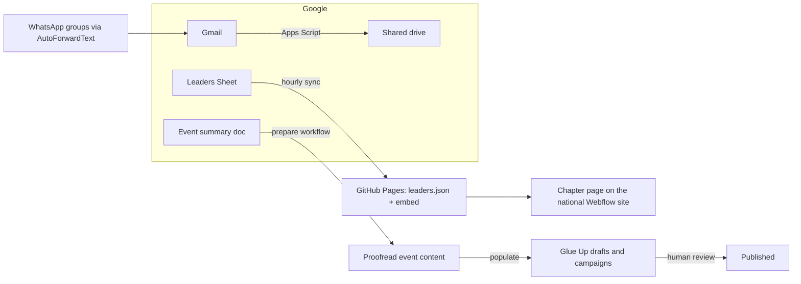

# YCP Automation

[](https://github.com/josephwhite-ai/ycp/actions/workflows/tests.yml)

Automation for the Central Connecticut chapter of Young Catholic Professionals (YCP), a volunteer-run organization. Each project takes a recurring volunteer chore and runs it on GitHub Actions, GitHub Pages or Google Apps Script, so nobody needs to keep a computer running.

Built with [Claude Code](https://claude.com/claude-code). Most commits are co-authored with Claude; the design decisions, review and operation are the maintainer's.

## Projects

| Project | Chore it replaces | Runs on | Tests |
| --- | --- | --- | --- |
| [webflow/](webflow/) | Asking the national site's admin to update the chapter's leaders | GitHub Actions (hourly) → GitHub Pages, plus an editor inside Google Sheets | 29 |
| [whatsapp/](whatsapp/) | Saving photos from the chapter's WhatsApp groups to the shared drive by hand | Google Apps Script (every 15 minutes) | 15 |
| [glueup/](glueup/) | Building each monthly event page and its invitation emails in Glue Up | GitHub Actions (prepare) + a local command (populate) | 36 |
| [bulletins/](bulletins/) | Reading parish bulletins for events to share | GitHub Actions, on demand | none (legacy) |



### webflow: chapter leaders without the CMS

The chapter page lives on the national YCP Webflow site, so the chapter couldn't edit its own leaders list. A small embed script fills the leaders sections from a JSON file the chapter publishes to GitHub Pages. That file is synced every hour from a Google Sheet, where editors use a dialog to draft, preview and publish changes, including uploading headshots, which are resized automatically.

**Built to fail safely:** a bad row or an unreadable photo stops the deploy and the site keeps the last good list. Drafts are kept on a separate tab that the sync never reads. If two editors save at once, the later save is refused instead of overwriting the other.

### whatsapp: photo saver

A phone in the chapter's WhatsApp groups forwards messages to Gmail. An Apps Script files the photos from people on the team roster into `<year>/<month>` folders on the shared drive. It reads the roster fresh on every run, skips photos it already saved, and stops with an error, rather than quietly saving nothing, if the roster can't be read.

### glueup: monthly event preparation

Turns the monthly event summary Google Doc into a ready-to-review Glue Up event and two invitation email campaigns. It extracts the doc's tables, picks the approved Glue Up template for the event type, generates and proofreads public copy with Gemini, and fills the drafts. **A person always reviews and publishes the event;** the agent never publishes it, and scheduling the emails is a separate step after that review. See [glueup/ROADMAP.md](glueup/ROADMAP.md) for what's next.

### bulletins: event extraction (legacy)

The repository's first project: two scripts that pull event announcements out of parish bulletin PDFs with an LLM (one with Gemini, one with Claude) and save them as a text file in Drive. It is kept running but isn't developed further.

## Running the tests

Each project has its own tests, and [.github/workflows/tests.yml](.github/workflows/tests.yml) runs all of them on every pull request.

```bash
(cd webflow && npm ci && npm test)
```

```bash
(cd glueup && npm ci && npm test)
```

```bash
node --test whatsapp/PhotoSaver.test.js
```

## Workflows

- `tests.yml`: runs every project's tests on pull requests and pushes to `main`.
- `webflow-pages.yml`: syncs leaders from the Google Sheet and publishes them to GitHub Pages.
- `glueup-monthly-prepare.yml`: prepares a month's Glue Up event content from Google Drive.
- `glueup-banner-scan.yml`: scans event folders for usable banner images.
- `ocr-pdf-gemini.yml`, `ocr-pdf-claude.yml`: run the bulletin extractors.

## Secrets and variables

- `GOOGLE_SERVICE_ACCOUNT_JSON`: service account used by the bulletin, Glue Up and Webflow workflows.
- `GEMINI_API_KEY`: Gemini bulletin extractor and Glue Up copy generation, proofreading and banner ranking.
- `ANTHROPIC_API_KEY`: Claude bulletin extractor.
- `LEADERS_SHEET_ID` (repository variable): the Google Sheet the leaders are published from.

No credentials are stored in the repository. Browser sessions, `.env` files and run outputs are git-ignored.

## License

[MIT](LICENSE)
